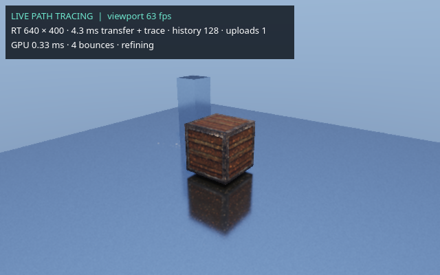

# Preview lighting in the live viewport

In **Graphics**, enable **Realtime GPU renderer** and set **Viewport shading** to
**Reference lighting (path tracing)**. This is the default GPU shading mode.
The existing **Hybrid lighting** mode remains in the same selector.

You can also open **Path-Traced Reference / Export**, select the GPU backend, and
click **Use this result in the viewport**. This closes the preview and transfers its
width, sample target, four-bounce setting and reference exposure (1.0) to the live
viewport. It turns off bloom, god rays and height fog for a closer reference match;
you can re-enable those effects in Graphics. AO and SSR are bypassed in full-frame
mode because its radiance already includes occlusion and reflections.

The viewport uses the same GPU path-shading function as the reference image,
including its direct lighting, sky, shadows, multi-bounce GI, reflections, textures
and material model. It replaces raster lighting with that radiance rather than
adding a small indirect contribution to a differently lit raster image.

## Smooth movement and stationary quality

- While the camera moves, trace one sample per update at no more than half the
  configured maximum width. Cached geometry and pipelines stay on the GPU.
- After about 150 ms without camera movement, use the configured resolution and
  trace up to four new samples per update until the convergence target is reached.
  The Vulkan GPU retains their sum, so displaying a later update includes every
  sample even if the UI skipped an earlier update.
- The GPU reprojects compatible history, rejects changed surfaces and limits old
  samples during motion. It filters the HDR result and upsamples it against the
  raster depth/normals before applying exposure and tone mapping.
- Sky radiance has its own rotation-only reprojection. New scene edits clear history.
- The raster viewport fills areas without valid current ray data while the worker
  catches up. It remains interactive during scene preparation.

Convergence samples can range from 1 to 512, path bounces from 1 to 8, and maximum
trace width from 160 to 1920. Trace height is limited to 1080. Width may be reduced
further to follow the lighting budget or fit the viewport. **Fast / Balanced /
Detailed** select 480/640/960 width and 32/128/256 convergence samples for full-frame
mode. They retain the lighter settings when Hybrid lighting is selected.

The HUD reports viewport frame rate, actual trace resolution, worker time including
transfer, accumulated samples, scene uploads and GPU timestamp measurements. Camera
movement and switching shading mode should not increment scene uploads.

## Validation and limits

A local RTX 4060 test used a textured crate and a reflective floor at 640 × 400,
128 samples and four bounces. The live stationary image differed from the reference
by less than one display level per channel on average outside the HUD. The lighting
worker took about 4–6 ms for a stationary four-sample update and about 1.4–2 ms for a
moving one-sample update. These are measurements for that small scene, not a whole
engine FPS guarantee.

This gives the preview's material/lighting model in the viewport, with a quality
tradeoff during motion. It does not compute a converged 256-sample image from scratch
at every moving frame. Low sample counts can show noise; lower trace resolutions
soften small texture details and reflections. Temporal history can briefly lag
view-dependent lighting. Vulkan/OpenGL still exchange data through CPU memory, and
scene edits still rebuild acceleration structures. Hardware tracing evaluates its
own PBR material model; arbitrary user vertex/fragment GLSL is not evaluated.

See [RealtimeHybridLighting.md](RealtimeHybridLighting.md) for the lighter hybrid
mode and [HardwareRayTracingAndTerrain.md](HardwareRayTracingAndTerrain.md) for
GPU requirements and terrain support.
