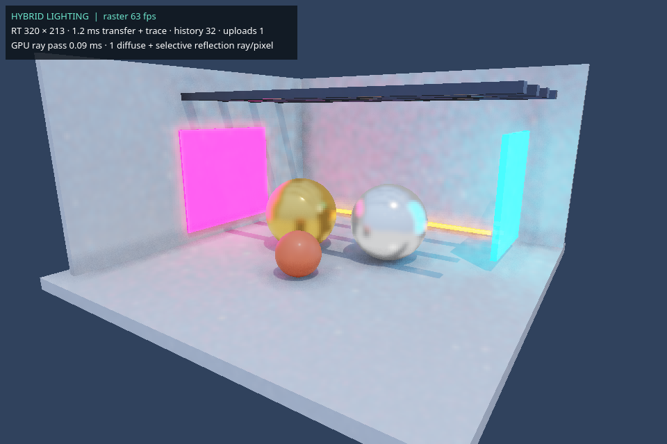

# Realtime hybrid lighting

The GPU viewport now defaults to **Reference lighting (path tracing)**. See
[LiveViewportPathTracing.md](LiveViewportPathTracing.md) to use the preview lighting
live. Select **Hybrid lighting** in Graphics to use the additive mode below.

Open **Graphics → Open Lighting Playground**, then enable **Realtime GPU renderer**
and select **Hybrid lighting**. The playground opens in a new scene tab and leaves
your existing scene open. It contains gold/chrome spheres, a ceramic sphere, emissive color panels,
and sun-shade beams. All its geometry and materials can be edited and saved.

Try the **Ray radiance only** debug view to see indirect illumination and
reflections without raster lighting. **Temporal history** shows red where history
is missing and green where it has accumulated. **Surface normals** helps inspect
geometry. Return to **Final image** for the combined result.

## Why the previous viewport was slow

The old viewport restarted a complete image render whenever the camera moved.
Every restart created a Vulkan device, uploaded textures, built acceleration
structures, created a pipeline, and ran CPU denoising/tone mapping. Its readback
also used uncached memory intended for CPU uploads.

The new worker keeps its Vulkan device and compute pipeline alive. Scene geometry,
BLAS/TLAS and textures stay uploaded until a scene edit. Camera movement updates
only the camera buffer. Shared materials are captured once, and hardware snapshots
skip the CPU tracer's BVH build. Rays write to device-local memory, followed by a
bulk copy into CPU-cached readback memory when the driver supports it.

The viewport no longer waits for a full path-traced image. The existing preview
window, now called **Path-Traced Reference / Export**, retains that slower mode
for reference renders and saved images.

## Frame steps

1. Rasterize geometry, direct sun lighting and shadow maps at viewport resolution.
2. On the worker, trace primary visibility into a small lighting buffer. Trace one
   cosine-weighted diffuse ray for nonmetals and one GGX reflection ray for surfaces
   with roughness below 0.65. Each secondary hit evaluates emission and shadowed sun
   lighting. A miss samples the sky. This gives one indirect bounce, including
   geometry and emitters outside the screen.
3. Copy linear HDR lighting and world normals/ray distances to OpenGL. There is no
   per-pixel CPU denoising, tone mapping or QImage conversion on this path.
4. A GPU pass reprojects the previous lighting history using camera matrices. It
   rejects mismatched normals/depth and limits history during camera movement.
5. The final GPU pass filters and upsamples lighting against the full-resolution
   depth/normals, then adds it before AO, fog, bloom and tone mapping. SSR supplies
   its usual screen-space fallback where ray lighting has no valid coverage.

New camera requests replace pending work and let the current small pass finish.
The completed buffer can be reprojected onto the latest camera, so continuous camera
input does not keep cancelling all lighting work. A scene edit invalidates history
and rejects pending frames from the previous scene. Raster rendering remains live
while the scene is prepared. Lighting converges over several updates when stationary
and sleeps after the requested history sample count.

OpenGL passes explicitly restore blend state after the Qt HUD. Depth/normal history
is numeric data; alpha blending would corrupt it.

## Controls and timings

- **Fast / Balanced / Detailed:** 240/320/640 maximum lighting width and 16/32/64
  history samples. Geometry and material edges remain at viewport resolution.
- **Lighting budget:** adapts ray-buffer width between 160 and your maximum. This
  budget measures the worker's trace, GPU wait, transfer and CPU buffer packing;
  it does not guarantee a whole-frame FPS.
- **GPU edge-aware filter:** controls the depth/normal guided spatial filter.
  Temporal accumulation remains active.
- **Indirect strength:** scales the additional GI/reflection contribution.
- The HUD shows raster frame rate, actual lighting resolution, total lighting update
  time, history samples, and scene upload count. Camera movement should not increment
  scene uploads. GPU dispatch time comes from Vulkan timestamps when supported.

A local RTX 4060 test with a single cube at 320 × 180 measured roughly 1.1–1.3 s
per camera restart in the previous renderer. A warm hybrid lighting update measured
about 0.8 ms including transfer and packing; initial scene/device setup was about
0.25 s. These are different workloads: the hybrid pass computes a bounded indirect
lighting contribution, while the previous path traced the complete image. They are
not a whole-frame performance claim or a guarantee for larger scenes.

## Limits

This follows the broad hybrid-rendering approach described in Epic's
[hardware ray tracing documentation](https://dev.epicgames.com/documentation/unreal-engine/hardware-ray-tracing-in-unreal-engine).
It is an Eldridge implementation; it does not contain Unreal's Lumen, Nanite,
Surface Cache, TSR or virtual shadow maps.

Lighting still passes through CPU memory between Vulkan and OpenGL. Scene edits
rebuild acceleration structures; there is no incremental refit or instance streaming.
The lighting pass has one indirect bounce and uses a small temporal/spatial filter.
Small emitters, thin geometry and fast reflection changes can still produce noise,
missed lighting or history lag. Indirect lighting is added to the raster material's
existing ambient term, rather than replacing it with an energy-calibrated lighting
model. Arbitrary shader behavior, alpha geometry and ray-traced participating media
are not evaluated by the hardware material model. The existing texture/material
limits are described in [HardwareRayTracingAndTerrain.md](HardwareRayTracingAndTerrain.md).
