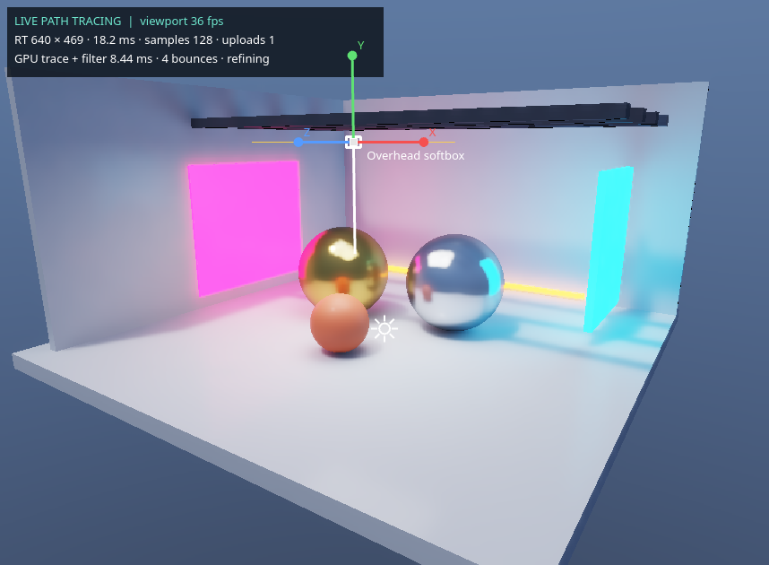
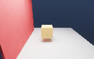

# Vulkan lighting and gizmos

This update adds a Vulkan denoiser, improved sampling, editable scene lights, and transform handles. It does not implement the entire Unreal renderer. These are Eldridge implementations, not Epic's Lumen, Nanite, Virtual Shadow Maps, or TSR.

## Try it

1. Build and start `build/EngineLabs`.
2. In **Graphics**, enable **Realtime GPU renderer** and choose **Reference lighting (path tracing)**. This requires a GPU supporting Vulkan ray queries.
3. Enable **Ray traced global illumination** and **GPU edge-aware filter**. Start with 640 trace width, 128 convergence samples, 4 bounces, 3 filter passes, and 2 samples while moving.
4. Use **Create Light** for a directional, point, spot, or rectangle light. You can also choose a light in **Create Object**.
5. Select the light in the hierarchy or click its icon in the viewport. Its **Light** inspector controls color, intensity, range, shadows, and source shape. Larger source radius/angle gives softer Vulkan shadows. Rectangle width/height controls its area.
6. Select any object and use **W** to move, **E** to rotate, or **R** to scale. Drag a colored handle; the center square in scale mode scales all axes. **Local** uses object axes (scale always uses local axes). **Snap** uses 0.5 units, 15 degrees, and 0.1 scale increments. **Escape** cancels the drag; each completed drag is one undo step.
7. Hold the right mouse button for the existing camera controls. **F** focuses the selection. Terrain painting takes precedence over transform handles while a brush is active.
8. **Open Lighting Playground** demonstrates emissive GI, reflected lighting, a soft sun, and an overhead rectangle light.

Light components and transforms are included in scene saves, projects, prefabs, and undo/redo. Graphics quality controls are saved with projects.

A light emits along its local **-Z** axis. Rotate it with the gizmo or Transform inspector. Intensities use engine units, not calibrated lumens/lux. A preview sun is used only when there are no light components in the scene. Disabling all existing lights does not turn that preview sun back on. Sky illumination has its own intensity control.

## What reduces noise

- Emissive triangles are sampled explicitly, weighted by area and brightness. Multiple importance sampling combines these samples with rays from the material. Small emitters no longer depend entirely on lucky bounce hits.
- GGX visible-normal sampling reduces wasted reflection samples. A rotated low-discrepancy sequence distributes primary samples across each pixel.
- The Vulkan filter uses increasing pixel spacing over 1–4 passes. Luminance variance controls smoothing; depth, normal, material, albedo, and roughness guide edges.
- Raw accumulated samples remain in a separate buffer. Filtered images never feed back into the accumulation.
- Moving cameras default to two samples per update at reduced resolution. Stationary views accumulate and refine at a higher resolution.
- **Indirect firefly clamp** limits bright indirect samples. Zero disables the clamp for reference work; clamping trades some accuracy for stability. Thin details and moving reflections can still be noisy at low resolution.
- Display controls such as debug view and exposure preserve converged GPU samples. Tracing quality changes, lights, geometry, and material edits reset them.

The existing OpenGL presentation pass still reprojects history and upsamples the Vulkan result. This is a Vulkan lighting backend inside the Qt/OpenGL viewport, not a new Vulkan swapchain renderer. CPU readback remains, so large resolutions and scenes have a performance cost.



## Light support and limits

| Feature | Vulkan full-frame | Raster / hybrid direct pass |
| --- | --- | --- |
| Directional, point, spot, rectangle lights | Yes | Yes, samples source centers |
| Source size and soft shadows | Yes, ray queried | No local light shadow maps |
| Diffuse global illumination / color bounce | Multi-bounce path tracing | Vulkan indirect contribution in hybrid mode |
| Reflections, emissive geometry, PBR textures | Yes | Existing raster materials + hybrid reflections |
| Maximum enabled lights | 64; larger counts report an error | First 32 lights |

Adding scene lights disables the old fixed preview-sun shadow map in raster mode, because that map does not match their positions. Use full-frame Vulkan for correct scene-light shadows. Rectangle emission is front-facing; emissive mesh materials are treated as two-sided. The CPU reference preview retains its previous, smaller lighting feature set. Custom GLSL is still evaluated by the raster renderer; Vulkan reads the supported material properties rather than executing arbitrary custom GLSL.

Gizmo translation handles parent transforms. Local rotation and scale operate on the local transform. World rotation uses an orthonormal parent basis; a nonuniformly scaled, rotated parent can introduce shear that plain position/Euler/scale cannot represent exactly. Singular parent transforms reject drags. Near edge-on rotation rings have limited screen space for picking. Mesh picking currently checks CPU triangles when clicked, so very large terrain meshes can make picking slower.

Remaining Unreal-scale work includes a surface/probe GI cache, reservoir sampling, motion-vector denoising, temporal super resolution, virtualized geometry, streaming, cascaded/virtual scene-light shadow maps, translucency and skeletal ray tracing. The current path tracer is not a Lumen equivalent and does not guarantee a fixed frame rate.

## Verification

On the RTX 4060, the 8-sample test scene's display-space mean absolute error against an unfiltered 256-sample reference decreased from **5.50/255** to **1.74/255** with the Vulkan filter (about **68%**). This measurement is for the included test fixture, not a claim about every scene.

| 8 samples, raw | 8 samples, Vulkan filter | 256 samples, raw reference |
| --- | --- | --- |
|  |  |  |

The editor smoke check also exercised all four creation actions, light intensity editing, viewport icon selection, dragging the scale handle, undo/redo, and the GI playground. The converged playground presented approximately 59–61 frames per second on this machine at 640 × 469 trace resolution. During convergence, tracing/filtering and readback took roughly 10–18 ms per update; UI presentation and worker throughput are separate measurements.

`HardwareRayTracingTests` checks noise reduction, all four lights, GI contribution, off-screen emission, raw sample accumulation, camera resource reuse, cancellation, and light limits. `EditorLightingTests` checks light serialization, disabled lights, invalid scene rejection, prefabs, undo/redo, parent-aware translation, uniform scale, cancellation, and project quality settings. The existing raster, shaders, terrain, camera, persistence, and prefab tests also pass.

To rebuild the compute shaders after editing GLSL, install `glslangValidator` and configure CMake again, or compile both files manually:

```sh
glslangValidator --target-env vulkan1.2 -V assets/shaders/hardware.comp -o assets/shaders/hardware.comp.spv
glslangValidator --target-env vulkan1.2 -V assets/shaders/denoise.comp -o assets/shaders/denoise.comp.spv
cmake -S . -B build
cmake --build build -j4
ctest --test-dir build --output-on-failure
```

Both SPIR-V files are included so normal builds do not require the GLSL compiler.

## Reading the code

`LightComponent` stores the light's values and converts them to world space. `LightWidget` edits those values. `TransformGizmo` projects and draws handles and applies changes to a `TransformComponent`. `Renderer` connects these helpers to selection, input, and undo. `VulkanRayTracer` uploads the lights and dispatches `hardware.comp` followed by `denoise.comp`; `HardwareViewport` keeps that work off the UI thread.

Background reading: [Epic's hardware ray tracing documentation](https://dev.epicgames.com/documentation/unreal-engine/hardware-ray-tracing-in-unreal-engine) and [NVIDIA's SVGF paper](https://research.nvidia.com/labs/rtr/publication/schied2017spatiotemporal/). Eldridge's filter is a simpler spatial variance-guided filter with the existing history reprojection; it does not implement the complete SVGF algorithm.

## Files changed

- `CMakeLists.txt`
- `src/main.cpp`
- `src/modules/componentsBackend/LightComponent/LightComponent.h`
- `src/modules/componentsBackend/LightComponent/LightComponent.cpp`
- `src/modules/scene/Scene.h`
- `src/modules/scene/Scene.cpp`
- `src/modules/scene/SceneSerialization.cpp`
- `src/modules/editor/LightWidget.h`
- `src/modules/editor/LightWidget.cpp`
- `src/modules/editor/TransformGizmo.h`
- `src/modules/editor/TransformGizmo.cpp`
- `src/modules/editor/InspectorWidget.h`
- `src/modules/editor/InspectorWidget.cpp`
- `src/modules/editor/HierarchyWidget.cpp`
- `src/modules/editor/ObjectCreationDialog.cpp`
- `src/modules/editor/RayTraceDialog.cpp`
- `src/modules/editor/LightingDemo.cpp`
- `src/modules/material/Material.cpp`
- `src/modules/renderer/Renderer.h`
- `src/modules/renderer/Renderer.cpp`
- `src/modules/renderer/VulkanRayTracer.h`
- `src/modules/renderer/VulkanRayTracer.cpp`
- `src/modules/renderer/HardwareViewport.cpp`
- `src/modules/renderer/RenderSettings.h`
- `assets/shaders/hardware.comp`
- `assets/shaders/hardware.comp.spv`
- `assets/shaders/denoise.comp`
- `assets/shaders/denoise.comp.spv`
- `assets/shaders/shaders.qrc`
- `assets/shaders/pbr.frag`
- `assets/shaders/hdrp.frag`
- `assets/shaders/terrain.frag`
- `assets/shaders/lit.frag`
- `assets/shaders/PBR.elsha`
- `assets/shaders/HDRP.elsha`
- `assets/shaders/Terrain.elsha`
- `assets/shaders/Lit.elsha`
- `tests/RenderingTests.cpp`
- `tests/EditorLightingTests.cpp`
- `tests/HardwareRayTracingTests.cpp`
- `docs/VulkanLightingAndGizmos.md`
- `docs/images/VulkanGIAndGizmos.png`
- `docs/images/VulkanNoiseRaw.png`
- `docs/images/VulkanNoiseFiltered.png`
- `docs/images/VulkanNoiseReference.png`
